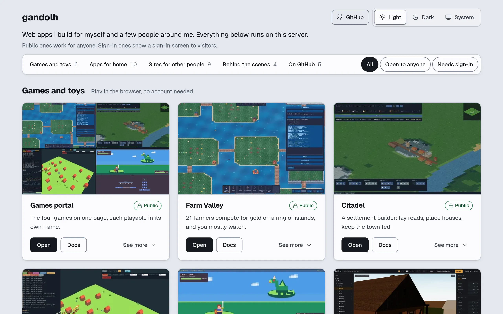
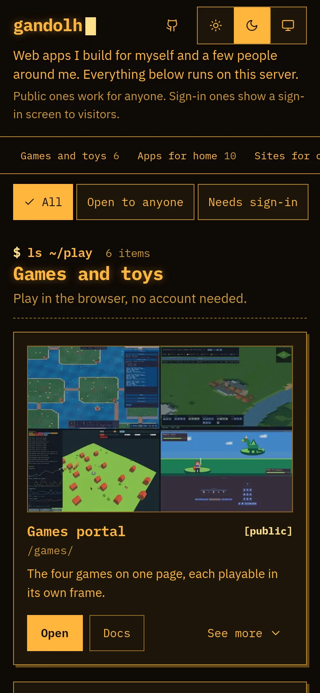
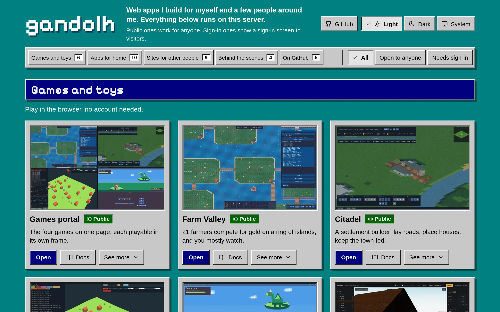
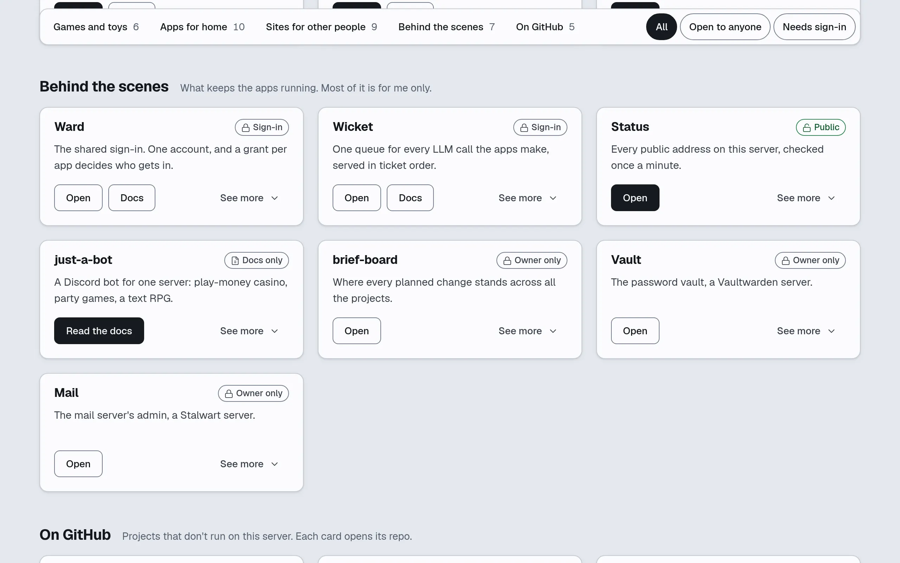

# Gatehouse

The page at the root of the owner's domain: every app, site and docs page the server answers, as grouped cards, for
anyone who arrives from a link and wants to find what they were sent to.

<p align="center">
  
</p>

**Status:** personal project, built and checked locally; waiting for its first deploy. The repo has no remote.

## What it does

- Lists 38 cards in five sections (Games and toys, Apps for home, Sites for other people, Behind the scenes, On GitHub),
  each with an access label that says what a visitor gets when they open it.
- Shows the page in three looks, Profile, Terminal and Ninety-six, each in light, dark or system mode.
- Opens a longer text, the address and the source inside the card with See more.
- Adds the owner's own cards (the vault, the mail admin, brief-board) after Sign in with Ward, from a small API.

Visitors never call that API, and the owner's cards are never in the public HTML. It shows nothing live: no up or down
label and no dates. English only.

## Screenshots

| Terminal on a phone, dark | Ninety-six, light |
|---|---|
|  |  |



The signed-in shot comes from the fake API. How each image was taken: [docs/images/shots.md](docs/images/shots.md).

## How it works

A React page on Vite is rendered to HTML at build time and hydrated in the browser, so every public card is in the HTML
and the page works with scripting off. `content/cards.json` is the one card list: the page build, the API and
vps-deploy's check all read it. The API is a Fastify server with Sign in with Ward; it answers only the owner. More in
[docs/architecture.md](docs/architecture.md).

## Run it locally

Requires Node 24.2 or newer.

```bash
npm install
npm run dev
```

Then open <http://localhost:5182/>. Add `?look=terminal` or `?look=ninety-six`, and `?mode=dark`, to see the other
looks. To draw the owner part without Ward, run `npm run dev:fake -w @gatehouse/web` instead. Setup, the checks and how
to add a card: [docs/getting-started.md](docs/getting-started.md).

## Project layout

| Path | What lives there |
|---|---|
| `shared/` | The card list's schema, its loader and the link resolver |
| `server/` | The Fastify API: Sign in with Ward and the owner's cards |
| `web/` | The React page, its build and its prerender |
| `content/` | `cards.json` and the card pictures |
| `design/` | The approved design, read only |
| `infrastructure/` | The API's Dockerfile and compose file |
| `corpus/` | The wiki, the briefs and the log |

## Docs

- [docs/](docs/README.md): getting started, architecture, design, the owner's setup
- [corpus/](corpus/index.md): decisions, status and the work log

## License

No license yet; all rights reserved.
