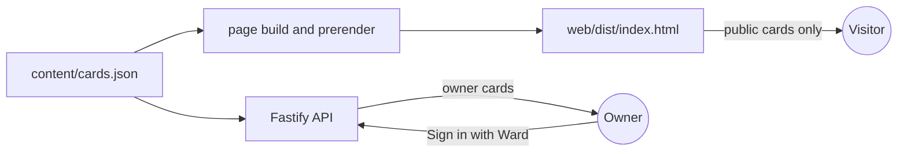

# Architecture

Three npm workspaces. `shared` holds the card list's schema, its loader and the link resolver. `server` is a Fastify 5
API, laid out as the `code-structure` skill says, that does Sign in with Ward and answers the owner's cards. `web` is a
React 19 page on Vite, rendered to HTML at build time and hydrated in the browser, with Base UI for the controls and
Tailwind 4 for the one stylesheet.

## The main flow

1. The build reads `content/cards.json` through `shared`, keeps the public part only, and turns each card's link into an
   address with `GATEHOUSE_ORIGIN`.
2. Vite's client and SSR builds and the prerender write `web/dist/index.html` with every public card in it. A path check
   holds every file the page loads under `/gatehouse/`, and a guard fails the build if any owner card's text appears.
3. A visitor gets that HTML at exactly `/`. React hydrates it; the look, mode, filters and See more work from there.
4. The owner presses Owner sign-in in the footer. The page sets a hint in localStorage and posts to the API, which sends
   the browser to Ward and sets a session cookie on the way back.
5. After mount, and only with the hint, the page calls the API's owner route. A 200 adds the owner's cards to Behind the
   scenes; a 401 or 403 drops the hint or says why. A visitor never calls the API.

The API sleeps behind Sablier when idle, so the first owner request waits while it wakes; the page shows that.

## Read more

- [corpus/wiki/architecture.md](../corpus/wiki/architecture.md): addresses, the build, ports, settings, hydration, the
  build guard and the container.
- [corpus/wiki/sign-in.md](../corpus/wiki/sign-in.md) and [corpus/wiki/owner-part.md](../corpus/wiki/owner-part.md): the
  owner part.
- [corpus/wiki/decisions.md](../corpus/wiki/decisions.md): why it is shaped this way.
- [owner-setup.md](owner-setup.md): the deploy's spec.
